# kdash 4.12

[](https://github.com/dheer629/kdash/actions/workflows/ci.yml)
[](LICENSE)
[](#install--upgrade-from-3x)
[](kdash)
[](kdash)

**Author:** Dheeraj V

> **Disclaimer.** kdash is provided as is, without warranty of any kind. The person running
> this utility is solely responsible for its use, for having authorisation to access the
> clusters and namespaces it reads, and for any decision or action taken on its output.
> kdash only reads the cluster, and **every run is audited**: the user, host, origin,
> context, namespace, every action taken in the dashboard, every report written and every
> kubectl call are logged and stored (local audit log, central audit log, syslog).
> The disclaimer is accepted once per user (`yes` at the first interactive run, or
> `--accept-disclaimer` / `KDASH_ACCEPT_DISCLAIMER=1` for automation).

Live Kubernetes namespace operations dashboard for the terminal, built for DevOps teams
running platform namespaces on management hosts. One Bash file, no build step, no jq,
no Python. It reads `kubectl`, joins everything locally, and gives you seven views.
Press `?` in any view for an explanation of what is on screen.

| Key | View | What it answers |
|---|---|---|
| `1` | **PODS** | What is each pod and container using, against its requests and limits? |
| `2` | **NODE POOLS** | This namespace against the whole cluster, per pool and per node: every node (also the ones without pods of the namespace), what this namespace uses and requests, and what all namespaces request / use. |
| `3` | **WORKLOADS** | Every Deployment / StatefulSet / DaemonSet / CronJob: ready vs desired replicas, rollout, its pods (status, node, CPU, memory, IP), image, and a pods-per-node matrix that shows HA risk at a glance. |
| `4` | **IP POOL** | Which IPs does the namespace hold, per node, per subnet, per service? Any pod with no IP, a host-network IP or a duplicate IP? |
| `5` | **MEMORY** | Live memory dashboard: memory and CPU time charts (host clock, start / middle / end times, request and limit lines, event markers), session events, per-node bars, pods by memory, OOM risk, **memory growth forecast** (when does a pod hit its limit), OOMKilled history and memory by workload. |
| `6` | **NET & DISK IO** | Network in (ingress) / out (egress) and disk read / write / IOPS over time and per worker node and per pod, with the namespace share of each node. |
| `7` | **ALERTS** | One live page for DevOps: the verdict (CRITICAL / WARNING / HEALTHY), a health line per section and every critical and warning signal from all sections. Each alert shows its age, live value and trend, with the kubectl action to run under it. NEW and recently cleared alerts are marked, followed by the live top consumers (memory, CPU, traffic) and events. |

Every view is live (no flicker, header and footer pinned, body scrolls), can be printed
once as text / TSV / CSV, and is exported to HTML. A live run records everything it
sees, and `x` writes **one HTML file with every tab plus the history since kdash started**.

## Screenshots

Every screenshot below is a saved live screen from a recorded validation run
(`kubectl` reads only, five minutes per namespace, three namespaces). The complete
set - all seven views for all three namespaces plus the help screen, the audit
table, a narrow terminal and the first-run disclaimer - is in
[`samples/`](samples/README.md), and the raw evidence behind it is in
[`artifacts/`](artifacts/README.md).

### 7 ALERTS - the one page an operator keeps open

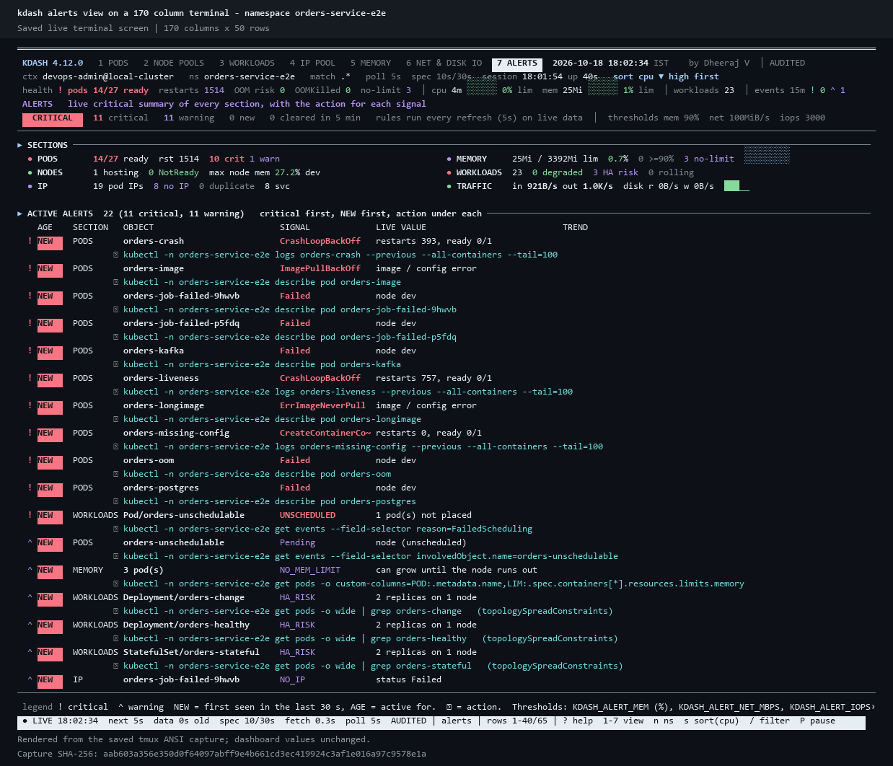

Verdict (`CRITICAL` / `WARNING` / `HEALTHY`), one health line per section, then every
critical and warning signal with its age, live value, trend and the `kubectl`
command to run under it - followed by the live top consumers and recent events.

### The other views, and the HTML report

| | |
|---|---|
| **1 PODS** - pod and container usage against requests and limits, grouped by workload<br>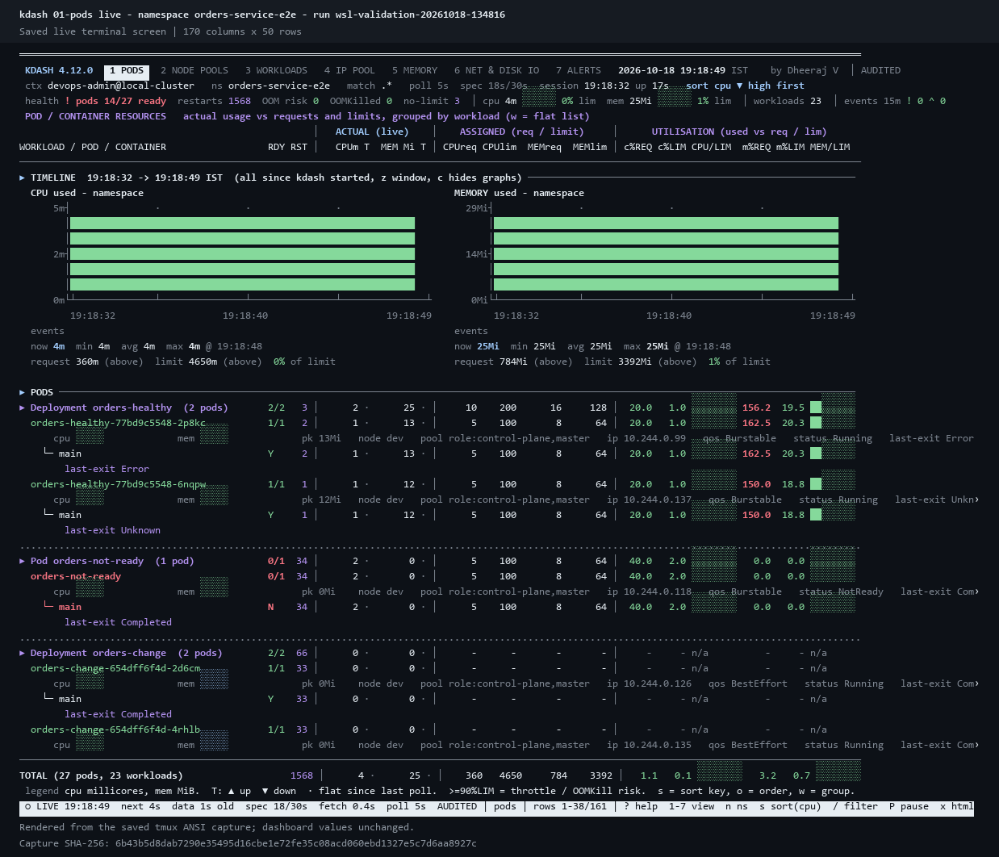 | **3 WORKLOADS** - replicas, rollout and the pods-per-node spread<br>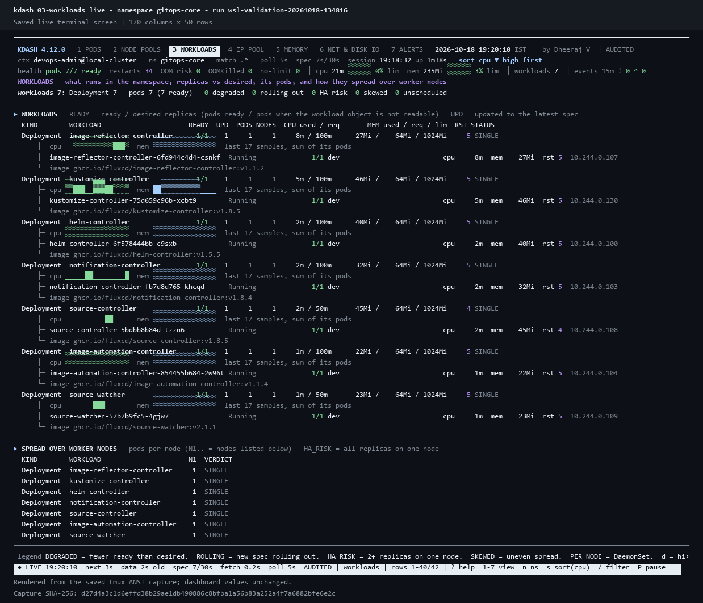 |
| **HTML report** - every tab plus the recorded history in one file, with filters and per-table CSV<br>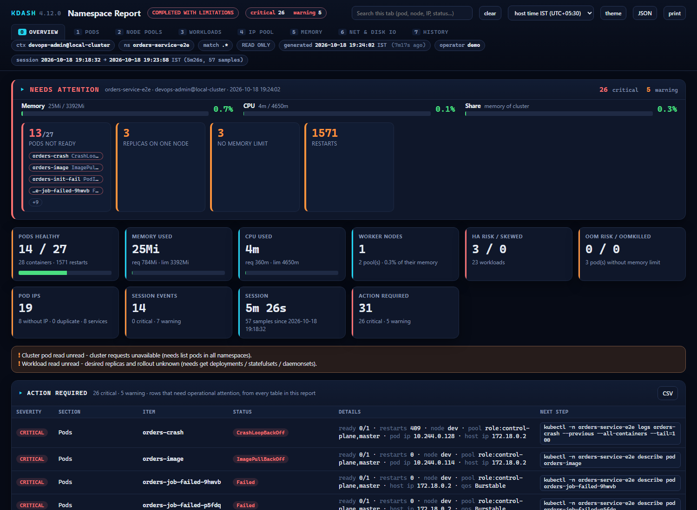 | **Audit table** - `kdash --audit`: every run, action, report and kubectl call<br>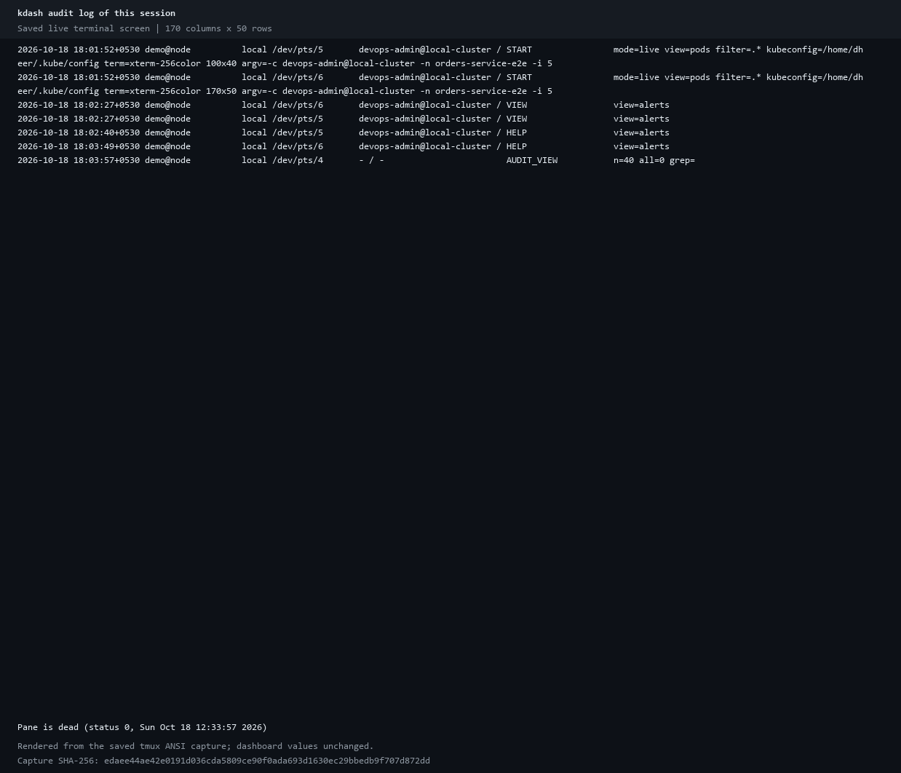 |

### All seven views, on a namespace with real problems

`orders-service-e2e` in the recorded run: 27 pods, 14 ready, a crash loop, an image
error, an unschedulable pod and 1571 cumulative restarts.

| View | What it answers | Screenshot |
|---|---|---|
| **1 PODS** | what each pod and container uses, against its requests and limits |  |
| **2 NODE POOLS** | this namespace against the whole cluster, per pool and per node | 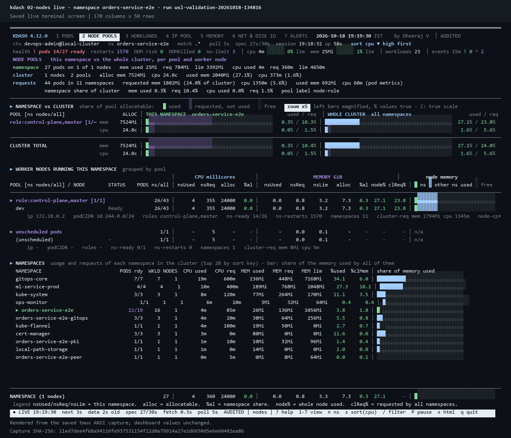 |
| **3 WORKLOADS** | ready vs desired replicas, rollout, and where the pods actually run | 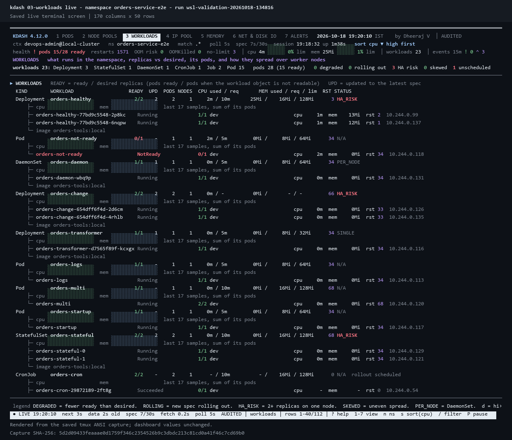 |
| **4 IP POOL** | pod IPs, node CIDR blocks, subnets, services, missing or duplicate IPs | 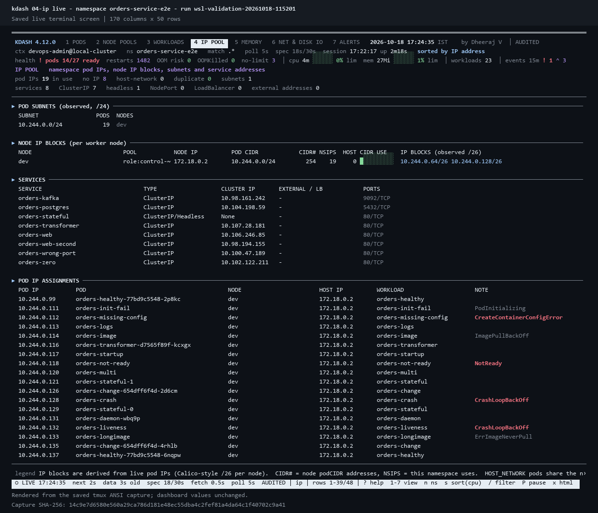 |
| **5 MEMORY** | live memory and CPU charts, OOM risk and the memory growth forecast | 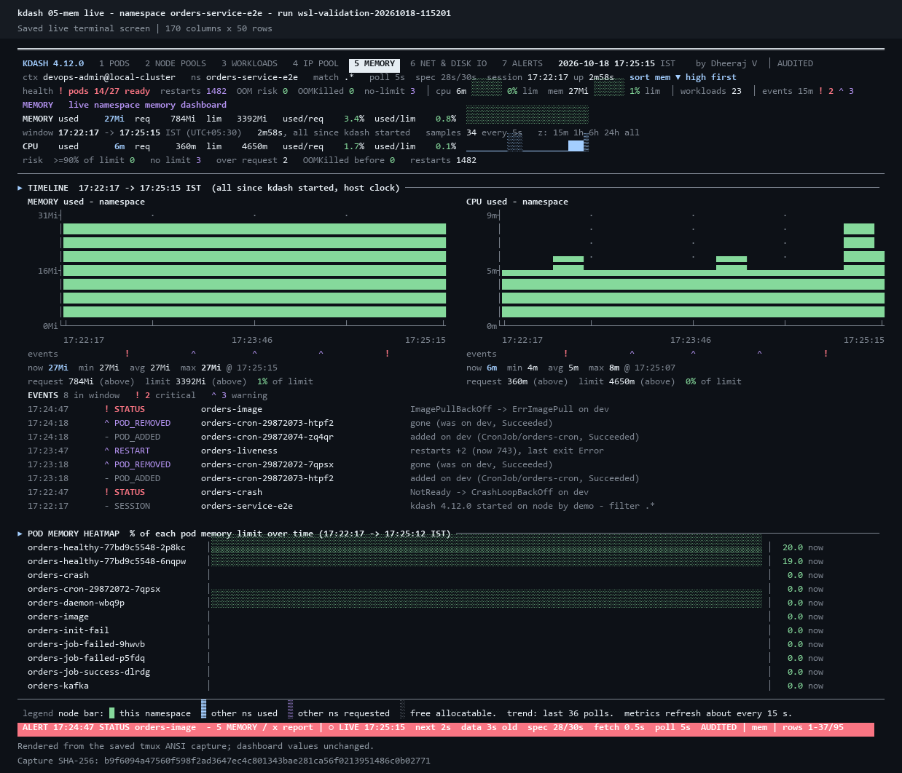 |
| **6 NET & DISK IO** | network in / out and disk read / write per node and per pod | 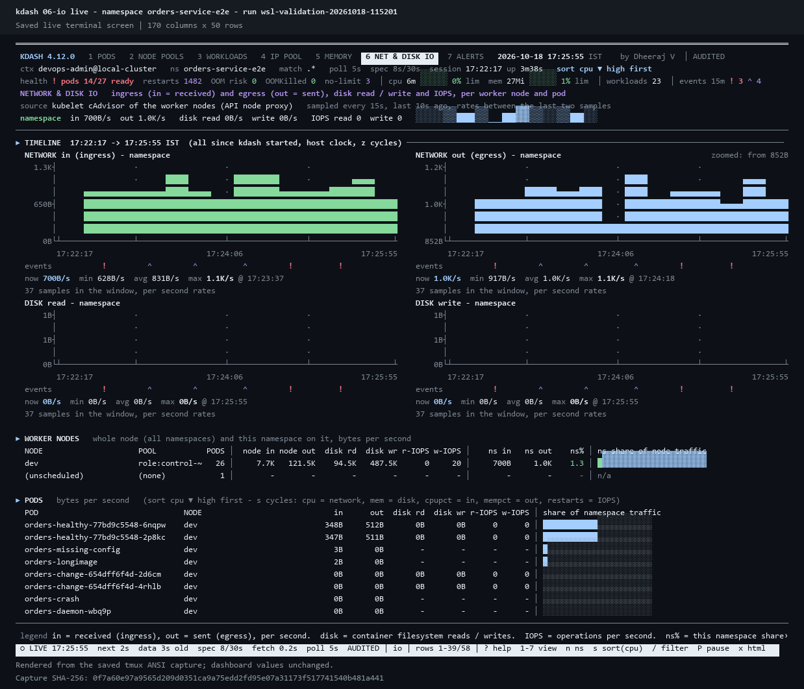 |
| **7 ALERTS** | everything that needs attention now, with the action for each signal | 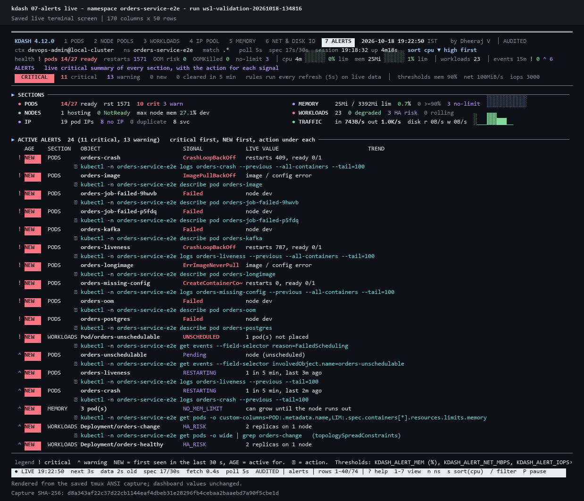 |

The same seven views are published for two quieter namespaces:
[`ml-service-prod`](samples/cli/ml-service-prod) (4 pods) and
[`gitops-core`](samples/cli/gitops-core) (7 pods).

### Around the dashboard

[help screen](samples/cli_7_alerts_help.png) ·
[help at 100 columns](samples/cli_7_alerts_help_narrow.png) ·
[100-column layout](samples/cli_7_alerts_100col.png) ·
[alerts over time, NEW and cleared](samples/cli_7_alerts_new_cleared.png) ·
[first-run disclaimer](samples/cli_disclaimer_first_run.png) ·
[declined disclaimer](samples/cli_disclaimer_declined.png) ·
[report footer with the disclaimer](samples/html_report_disclaimer_footer.png) ·
[HTML audit report](samples/html_audit_report.png) ·
[all HTML samples](samples/html) · [checksums](samples/SHA256SUMS)

The names in these images are generic placeholders, and the images are renders of
the saved terminal screens (not window captures): see
[`artifacts/README.md`](artifacts/README.md#redaction-the-names-here-are-placeholders).

## Install / upgrade from 3.x

```bash
bash kdash-bundle.sh          # current user  -> ~/.local/bin   (recommended per account)
sudo bash kdash-bundle.sh     # all users     -> /usr/local/bin (+ /etc/kdash.conf)
exec bash -l                  # load it in the current terminal
bash kdash-bundle.sh --check  # which kdash does a fresh login shell run?
```

Re-running is safe and always leaves the CLI on v4:

- **Old binaries:** every older `kdash` (version < 4) found on the login-shell PATH or
  in the usual bin directories is moved to `~/.kdash-old/`. For a root-owned copy
  (for example an old `sudo` install in `/usr/local/bin`) the exact `sudo mv` command
  is printed.
- **Old shell definitions:** `kdash()` functions or aliases from a platform CLI or the
  3.x block are listed as `file:line` and overridden. The integration lives in
  `~/.kdash-shell.bash`, sourced from a marker block at the **end** of both `~/.bashrc`
  and `~/.bash_profile`, so it loads after anything defined earlier. In it, `kdash`
  always calls the v4 binary, and that binary's directory is put first on PATH.
- **Self-check:** the installer finishes by starting a real login shell and checking
  that `kdash --version` reports 4.x. If it does not, it prints where to add the
  source line.
- **Namespace map:** when no `KDASH_NS_MAP` is configured, the built-in map
  (example-cl-1 -> 1152, example-cl-2 -> 1131, example-cl-3 -> 1131) is written to
  `~/.config/kdash.conf`, so plain `kdash` finds the right namespace even when the
  context binds none.

If your platform CLI regenerates `~/.bashrc` from a heredoc, add this as the last line of
that heredoc so a regeneration keeps v4:

```bash
[ -r "$HOME/.kdash-shell.bash" ] && . "$HOME/.kdash-shell.bash"
```

Options: `--prefix DIR`, `--no-shell`, `--keep-old`, `--check`, `--uninstall`.

### Uninstall

The separate `kdash-uninstall.sh` works without the installer or a cluster connection:

```bash
bash kdash-uninstall.sh --dry-run          # preview removal
bash kdash-uninstall.sh                    # current user's installation
sudo bash kdash-uninstall.sh               # system installation
bash kdash-uninstall.sh --prefix /opt/bin   # same directory used for installation
```

It removes the selected `kdash` binary, completion and the current user's shell
integration. The kdash setup blocks in `~/.bashrc` and `~/.bash_profile` are removed
after backing up those files; unrelated content and startup-file symlinks are
preserved. Malformed setup blocks stop removal with an error. Re-running is safe.
`--no-shell` keeps the shell integration and startup blocks while removing the binary
and completion. If the shell integration points to another installation prefix, it
and its completion are kept.

Configuration, disclaimer acceptance, reports, sessions, audit logs, startup backups
and `~/.kdash-old` are retained. Running dashboards continue until you quit them.
Open a new terminal after uninstalling to clear loaded functions and command caches;
older aliases or installations that were previously overridden may become visible.
The root command uses its current `HOME` and does not edit other users' homes.

`bash kdash-bundle.sh --uninstall` uses the same removal logic and also accepts
`--prefix`, `--no-shell` and `--dry-run`. The bundle remains a self-contained file.

Run `bash tests/test-uninstall.sh` as a regular user to test installation and removal
inside temporary home directories. The tests use a stub `kubectl` and do not access
a cluster.

Shell shortcuts (namespace follows your shell via `_ns()`, `$KDASH_NS` or `$PLATFORM_NS`,
unless you pass `-n` or `-A`):

| Shortcut | Runs |
|---|---|
| `kdash` / `kdpods` | 1 pods view, live |
| `kdnodes` | 2 node pools view |
| `kdwl` | 3 workloads per worker node + HA spread |
| `kdip` | 4 namespace IP pool |
| `kdmemlive` | 5 live memory dashboard |
| `kdsnap [sel]` | one HTML report per view: `all` (default), `2`, `25`, `nodes,mem` |
| `kdreport` | combined HTML + TSV/CSV report bundle |
| `kdtop` `kdmem` `kdwatch` | sort by CPU % / memory % of limit, tight poll |
| `kd` | pods view, **only if `kd` is free** - platform shells use `kd` for `kubectl describe`, which is left alone |

All shortcuts accept the normal options, for example `kdnodes -i 5`,
`kdwl '^order-svc-1-' --once`, `kdmemlive -n demo-namespace-0001`.

**Requirements:** `kubectl`, `bash` 4+, any `awk` (tested identical on gawk, mawk,
one-true-awk and busybox awk), coreutils.

**Permissions:** the dashboard degrades view by view and says why on screen.

| Needs | Gives | Without it |
|---|---|---|
| get/list `pods`, `services` (namespace) | everything structural | kdash exits 1 (pods) / services section empty |
| get/list `pods.metrics.k8s.io` | live usage columns, trends | requests / limits still shown, usage `-` |
| get/list `nodes` (cluster) | pools, allocatable, podCIDR, node IP, NotReady / cordoned | nodes taken from pod placement, pool `(unknown)` |
| get/list `nodes.metrics.k8s.io` | whole-node memory, other-namespace share in the bars | bars show this namespace vs allocatable only |

## Usage

```bash
kdash                                   # pods, current namespace, live
kdash -v nodes                          # node pools, live
kdash -v workloads '^order-svc-1-'      # where those pods run + HA spread
kdash -v ip --once                      # IP pool snapshot
kdash -v mem -i 5                       # memory dashboard, 5 s poll
kdash -v all --once > snapshot.txt      # every view as plain text
kdash -v nodes --once -o csv            # node pool table as CSV
kdash --report                          # HTML + text + TSV + CSV bundle in ~/kdash_reports
kdash -A -v mem                         # every readable namespace
kdash -n                                # pick the namespace from a list first
kdash -v nodes --theme light            # darker colours for a white terminal
kdash -v io --prom-svc prometheus:9090        # network / disk IO from the namespace Prometheus
kdash -s mem --reverse                  # smallest memory first
```

### Options

| Flag | Meaning |
|---|---|
| `-v, --view VIEW` | `pods` `nodes` `workloads` `ip` `mem` `io` `all` (aliases: `pool`, `wl`, `ippool`, `memory`, `net`, `1`-`6`) |
| `-o, --output FMT` | with `--once`: `text` (default), `tsv`, `csv` - the view's tables with `# name` headers |
| `--report [DIR]` | write the evidence bundle and an HTML dashboard, then exit (default `~/kdash_reports`) |
| `--pool-label KEY` | node label that names the pool (default: auto-detect) |
| `--top N` | rows in "top pods" / workload memory lists (default 15) |
| `--no-node-metrics` | never call `kubectl top node` |
| `--no-cluster` | skip the all-namespaces pod read (cluster requests, pods per node) |
| `--hosting-nodes` / `--all-nodes` | NODE POOLS lists only nodes running the namespace / every node (default) |
| `--theme NAME` | `safe` (default), `dark`, `light`, `mono` |
| `--glyphs SET` | `safe` (default, PuTTY-friendly), `full`, `ascii` |
| `-s KEY` `--reverse` `--flat` | sort key (`cpu mem cpupct mempct restarts name`), lowest first, PODS without workload groups |
| `--prom-url URL` `--prom-svc SVC` `--io-wait SEC` `--no-io` | IO source, one-shot IO sampling, IO off |
| `--window DUR` | time-chart window: `15m` `1h` `6h` `24h` `all` (default all since start; key `z`) |
| `-n` (no value), `--pick-ns` | choose the namespace from a list |
| `-n` `-A` `-c` `-k` | namespace, all namespaces, context (unique substring accepted), kubeconfig |
| `-i` `-R` `-1` | usage poll seconds, spec re-read seconds, render once |
| `-s` `-P` `-C` `-D` | sort key, pods only, force containers, hide detail lines |
| `--ascii` `-N` `-S` | ASCII glyphs, no colour, no alternate screen |

### Keys

| Key | Action | Key | Action |
|---|---|---|---|
| `1`-`6`, `Tab` | switch view | `x` | HTML report: all tabs + history since start |
| `e` | HTML menu (all-tabs report, current view, views 1-6, all, bundle) | | |
| `j` `k`, arrows | scroll | `/` | change pod regex live (empty = all) |
| `h` `l`, arrows | pan left / right | `0` | back to column 1 |
| `space` `b` | page | `g` `G` | top / bottom |
| `d` | detail lines (pod names in WORKLOADS) | `p` | pods-only (PODS) |
| `s` | cycle sort key (every view) | `o` | reverse sort order |
| `w` | PODS grouped by workload / flat | `?` | help for the view on screen |
| `r` | re-read spec now | | |
| `n` | pick another namespace | `a` | NODE POOLS: every node / hosting nodes only |
| `T` | colour theme | `z` | time-chart window: all since start, 15m, 1h, 6h, 24h |
| `Z` | NODE POOLS auto zoom / true scale | `P` | pause / resume live refresh (data frozen) |
| `+` `-` | poll interval 1, 2, 3, 5, 10, 15, 30, 60 s | | |
| `q` | quit | | |

Keys repaint from the local model and cost no API calls (`n`, `r` and the HTML keys read the cluster).

## The views

### 2 - NODE POOLS

Three blocks:

1. **Summary** - the namespace (pods, nodes it runs on, memory / CPU used, requested,
   limited), the whole cluster (nodes, pools, pods, namespaces, allocatable, requested
   and used by every namespace) and the namespace's share of the cluster. Lines starting
   with `!` say which data is missing and which RBAC right would provide it.
2. **NAMESPACE vs CLUSTER** - two graphs per pool, memory and CPU, both against the pool's
   allocatable: left = this namespace, right = every namespace. `█` used, `▒` requested
   but not used, `░` free. A totals row covers the whole cluster.
3. **WORKER NODES** - every node grouped by pool `[nodes running the namespace / nodes in
   pool]`. Nodes without pods of this namespace are grey; `a` hides / shows them
   (`--hosting-nodes` starts hidden). `PODS ns/all` = this namespace / every namespace on the
   node, `clReq%` = memory requested by all namespaces. The node bar shows this namespace
   (`█` green), other namespaces (`▓` blue = used, from node metrics; `▒` magenta =
   requested, when node metrics are not allowed) and free allocatable (`░` grey).

```
 namespace  14 pods on 4 of 6 nodes   mem used 18.1Gi  req 13.9Gi  lim 33.2Gi   cpu used 6141m  req 4850m  lim 20.8c
 cluster    6 nodes  4 pools  38 pods  5 namespaces   alloc mem 247.3Gi  cpu 66.8c   requested mem 95.1Gi (38.4%)  cpu 23.7c (35.5%)
            namespace share of cluster   mem used 7.3%  req 5.6%   cpu used 9.2%  req 7.3%   pool label example.com/nodepool
 ! node metrics forbidden - cluster "used" unavailable, the cluster graph shows requests (needs nodes.metrics.k8s.io)
────────────────────────────────────────────────────────────────────────────────────────────────────────────────────────────────────────────────────────────────
▸ NAMESPACE vs CLUSTER  per pool, share of pool allocatable:   █ used   ▒ requested, not used   ░ free
POOL [ns nodes/all]                 ALLOC │ THIS NAMESPACE  demo-test                     used / req │ WHOLE CLUSTER  all namespaces                 used / req
pool-app [2/3]               mem   175.8Gi │ ███░░░░░░░░░░░░░░░░░░░░░░░░░░░░░░░░░░░░░░   8.3% /  6.1% │ ▒▒▒▒▒▒▒▒▒▒▒▒▒▒▒▒▒▒░░░░░░░░░░░░░░░░░░░░░░░     -  / 44.8%
                            cpu     47.4c │ █████░░░░░░░░░░░░░░░░░░░░░░░░░░░░░░░░░░░░  11.2% /  7.2% │ ▒▒▒▒▒▒▒▒▒▒▒▒▒▒▒▒▒░░░░░░░░░░░░░░░░░░░░░░░░     -  / 41.0%
pool-general [2/2]          mem    57.2Gi │ ███░░░░░░░░░░░░░░░░░░░░░░░░░░░░░░░░░░░░░░   6.1% /  5.1% │ ▒▒▒▒▒▒▒▒▒▒░░░░░░░░░░░░░░░░░░░░░░░░░░░░░░░     -  / 23.3%
                            cpu     15.6c │ ██▒▒░░░░░░░░░░░░░░░░░░░░░░░░░░░░░░░░░░░░░   5.4% /  8.7% │ ▒▒▒▒▒▒▒▒▒░░░░░░░░░░░░░░░░░░░░░░░░░░░░░░░░     -  / 22.8%
role:control-plane [0/1]    mem    14.3Gi │ ░░░░░░░░░░░░░░░░░░░░░░░░░░░░░░░░░░░░░░░░░     -  /    -  │ ▒▒▒▒▒▒▒▒░░░░░░░░░░░░░░░░░░░░░░░░░░░░░░░░░     -  / 18.8%
                            cpu     3800m │ ░░░░░░░░░░░░░░░░░░░░░░░░░░░░░░░░░░░░░░░░░     -  /    -  │ ▒▒▒▒▒▒░░░░░░░░░░░░░░░░░░░░░░░░░░░░░░░░░░░     -  / 15.8%
────────────────────────────────────────────────────────────────────────────────────────────────────────────────────────────────────────────────────────────────
CLUSTER TOTAL               mem   247.3Gi │ ███░░░░░░░░░░░░░░░░░░░░░░░░░░░░░░░░░░░░░░   7.3% /  5.6% │ ▒▒▒▒▒▒▒▒▒▒▒▒▒▒▒▒░░░░░░░░░░░░░░░░░░░░░░░░░     -  / 38.4%
                            cpu     66.8c │ ████░░░░░░░░░░░░░░░░░░░░░░░░░░░░░░░░░░░░░   9.2% /  7.3% │ ▒▒▒▒▒▒▒▒▒▒▒▒▒▒▒░░░░░░░░░░░░░░░░░░░░░░░░░░     -  / 35.5%

▸ WORKER NODES  every node (a = hosting only)
                                                 │       CPU millicores       │                   MEMORY GiB                   │        node memory
POOL [ns nodes/all] / NODE STATUS    PODS ns/all │ nsUsed  nsReq  alloc   %al │  nsUsed   nsReq   nsLim   alloc   %al node% clReq% │ █ ns ▒ other ns requested ░ free
────────────────────────────────────────────────────────────────────────────────────────────────────────────────────────────────────────────────────────────────
▸ pool-app [2/3]                             7/21 │   5298   3400  47400  11.2 │    14.6    10.8    25.2   175.8   8.3     -   44.8 │ ██▒▒▒▒▒▒▒▒▒▒░░░░░░░░░░░░░
  worker-a1                Ready             4/9 │   4740   2650  15800  30.0 │    12.6     9.2    20.1    58.6  21.5     -   47.6 │ █████▒▒▒▒▒▒▒▒░░░░░░░░░░░░
  worker-a2                Ready             3/4 │    558    750  15800   3.5 │     2.0     1.6     5.1    58.6   3.4     -    3.8 │ █▒░░░░░░░░░░░░░░░░░░░░░░░
  worker-a3                Cordoned          0/8 │      -      -  15800     - │       -       -       -    58.6     -     -   83.1 │ ▒▒▒▒▒▒▒▒▒▒▒▒▒▒▒▒▒▒▒▒▒░░░░

────────────────────────────────────────────────────────────────────────────────────────────────────────────────────────────────────────────────────────────────
NAMESPACE (4 nodes)                           14 │   6141   4850  47200  13.0 │    18.1    13.9    33.2   174.4  10.4     -      - │ ███░░░░░░░░░░░░░░░░░░░░░░
 legend nsUsed/nsReq/nsLim = this namespace.  alloc = allocatable.  %al = namespace share.  node% = whole node used.  clReq% = all namespaces requested.
```

Where the cluster numbers come from: allocatable from `get nodes`, usage from `kubectl
top node` (nodes.metrics.k8s.io), requests and pods per node from one
`get pods --all-namespaces` (node, phase and resources only, re-read every `-R` seconds).
Each is optional: when RBAC denies one, its columns show `-` and the header says so.
`--no-cluster` (`KDASH_CLUSTER=0`) skips the all-namespaces read.

Pool auto-detection tries `agentpool`, `cloud.google.com/gke-nodepool`,
`eks.amazonaws.com/nodegroup`, `karpenter.sh/nodepool`, `node.kubernetes.io/pool`,
`nodepool`, `node-pool`, `pool`, then any label containing `pool` (for example
`example.com/nodepool`), then node roles. Pin it with `--pool-label` or `KDASH_POOL_LABEL`.

### 3 - WORKLOADS

Pods per worker node grouped by owning workload (ReplicaSet hashes and CronJob job
suffixes are folded back to the Deployment / CronJob name), then the spread table.

```
▸ PODS PER WORKER NODE ──────────────────────────────────────────────────────────────────────────────────────────────────────────────────────────────
    KIND        WORKLOAD                                      PODS READY  RST    CPUm   MEM Mi
▸ worker-a1  pool pool-app   pods 4 (ready 4)   cpu 4740m   mem 12.6Gi / req 9408Mi   21.5% of node
    DaemonSet   apps-log-shipper                                 1   1/1    0      30      180
    Deployment  order-svc-1-manager                              1   1/1    1    1710     3740
    StatefulSet order-svc-1-file-server-01-master                2   2/2    3    3000     9000
▸ worker-a2  pool pool-app   pods 3 (ready 3)   cpu 558m   mem 2038Mi / req 1600Mi   3.4% of node
    Deployment  order-svc-1-utility                              1   0/1    0       -        -

▸ WORKLOAD SPREAD / HIGH AVAILABILITY ───────────────────────────────────────────────────────────────────────────────────────────────────────────────
  KIND        WORKLOAD                                      PODS READY NODES MAX VERDICT                        MEM Mi  DISTRIBUTION (node:pods)
  CronJob     order-svc-1-housekeeping                         1     1     1   1 N/A                                 -  worker-a2:1
  DaemonSet   apps-log-shipper                                 2     2     2   1 PER_NODE                          350  worker-a1:1 worker-b1:1
  Deployment  order-svc-1-collector                            4     4     2   3 SKEWED                           2400  worker-a2:1 worker-b1:3
  Deployment  order-svc-1-dr-viewer                            1     0     1   1 SINGLE+NOT_READY                  280  worker-b2:1
  Deployment  order-svc-1-manager                              3     3     3   1 OK                               6517  worker-a1:1 worker-a2:1 worker-b1:1
  Deployment  order-svc-1-utility                              1     0     0   0 SINGLE+UNSCHEDULED+NOT_READY        -  -
```

| Verdict | Meaning |
|---|---|
| `OK` | replicas spread as evenly as the hosting nodes allow |
| `HA_RISK` | 2+ replicas, all on one node: one node failure takes the workload down |
| `SKEWED` | a node holds more replicas than an even spread would |
| `SINGLE` | one replica |
| `PER_NODE` / `N/A` | DaemonSet / Job, CronJob, bare Pod |
| `+UNSCHEDULED` `+NOT_READY` | pods pending placement / not ready |

### 4 - IP POOL

```
 IP POOL   namespace pod IPs, node IP blocks, subnets and service addresses
 pod IPs 11 in use   no IP 1   host-network 2   duplicate 0   subnets 4

▸ NODE IP BLOCKS (per worker node) ──────────────────────────────────────────────────────────────────────────────────────────────────────────────────
  NODE                           POOL           NODE IP          POD CIDR            CIDR# NSIPS  HOST CIDR USE    IP BLOCKS (observed /26)
  worker-a1                      pool-app        172.16.0.11      10.42.1.0/24          254     3     1 ░░░░░░░░░░  10.42.1.0/26
  worker-a2                      pool-app        172.16.0.12      10.42.2.0/24          254     3     0 ░░░░░░░░░░  10.42.2.0/26
  worker-b1                      pool-general   172.16.0.21      10.42.3.0/24          254     4     1 ░░░░░░░░░░  10.42.3.0/26
  worker-b2                      pool-general   172.16.0.22      10.42.4.0/24          254     1     0 ░░░░░░░░░░  10.42.4.0/26
```

It also lists the observed `/24` pod subnets, every service (ClusterIP, headless,
NodePort, LoadBalancer ingress, external IPs, ports) and every pod IP with a note:
`HOST_NETWORK`, `DUPLICATE`, `NO_IP`, or the pod status when it is not Running.
`CIDR#` is the node podCIDR size and `NSIPS` how many of those addresses this
namespace holds. IP blocks are derived from live pod IPs (Calico allocates /26 per node).

### 5 - MEMORY

```
 KDASH 4.4.0   1 PODS   2 NODE POOLS   3 WORKLOADS   4 IP POOL   5 MEMORY   6 NET & DISK IO    2026-10-16 06:43:58 IST
 ctx example-cluster-1   ns demo-test   match .*   poll 1s  spec 19s/30s  session 06:42:40 up 1m18s   sort mem ▼ high first
 MEMORY used   20.0Gi  req   13.9Gi  lim   33.2Gi   used/req  143.4%  used/lim   60.3%  ██████████████░░░░░░░░
 window 06:42:40 -> 06:43:58 IST (UTC+05:30)   1m18s, all since kdash started   samples 79 every 1s   z: 15m 1h 6h 24h all
► TIMELINE  06:42:40 -> 06:43:58 IST  (all since kdash started, host clock) ──────────────────────────────────
  MEMORY used - namespace                                                              zoomed: from 18.3Gi
  20.7Gi┤
        │                                                       ▄                         ▄
        │                                                 ▄     █       ▄  ▄        ▄█ ▄▄ ███▄ ██   ██    █  ▄
        │                ▄▄  ▄▄▄ █▄▄      █    ▄▄     ▄ ▄▄█     █       █▄▄█▄█   █▄▄██▄██ ████▄██▄▄ ██ █▄▄█▄ █
  19.5Gi┤     █     █   ███  ███▄███ █▄▄█▄█  ▄ ██▄▄██▄█ ███▄███▄█▄▄██  ▄██████▄▄▄█████████████████████████████
        │▄ ▄███   ███▄▄█████▄███████▄██████▄▄█▄████████ █████████████  ███████████████████████████████████████
        │█▄████▄██████████████████████████████████████████████████████████████████████████████████████████████
  18.3Gi└┴─────────────────────────────────────────────────┴─────────────────────────────────────────────────┴
         06:42:40                                      06:43:19                                       06:43:58
  events                                      !                                      ^
  now 20.0Gi  min 18.7Gi  avg 19.5Gi  max 20.2Gi @ 06:43:23
  request 13.9Gi (below)  limit 33.2Gi (above)  60% of limit
  EVENTS 3 in window   ! 1 critical   ^ 1 warning
  06:43:39       ^ STATUS           order-svc-1-manager-7d9f8c6b5-fghij      Running -> Pending on worker-a2
  06:43:09       ! OOMKILLED        order-svc-1-manager-7d9f8c6b5-abcde      restarts +2 (now 3), last exit OOMKilled
...
► MEMORY GROWTH FORECAST  (linear trend of the last 30m, a restart starts the trend again) ───────────────────
  POD                                  NODE         NOW    LIMIT   GROWTH/h  %LIM  LIMIT IN     REACHES LIMIT AT   TREND
  order-svc-1-file-server-01-master-1  worker-a1  3803Mi   8192Mi    +35.3Gi  46.4  7m17s        06:51:15           steady (r2 1.00, 79 samples)
```

- **Time charts** (memory and CPU, side by side on wide terminals): one bar per column, coloured
  by % of the limit (green < 50, blue < 75, magenta < 90, red >= 90). `=` is the limit and `-`
  the request when they fall inside the scale; a flat series is zoomed in so its movement shows
  (the axis says where the scale starts). Start, middle and end times on the axis, `!` critical
  and `^` warning events under it, then now / min / avg / max with the time of the peak.
- **Window**: `z` cycles all since kdash started, 15m, 1h, 6h, 24h (`--window`, `KDASH_WINDOW`).
  The charts read the session history (`KDASH_SAMPLE_EVERY`, default 15 s) and end at the clock.
- **Events**: the newest session events in the window with their time.
- **Forecast**: per pod, a least-squares trend over the last `KDASH_FORECAST_WINDOW` seconds
  (default 1800) of samples; a restart starts it again and noisy series are left out. It shows
  growth per hour, time left and the clock time the pod reaches its limit (red under 1 h).
  A linear estimate - caches and batch peaks level off, leaks do not.
- Below: per-node bars, top pods by memory, OOM risk (>= 90% of limit), pods whose last
  container exit was `OOMKilled`, pods without a memory limit, and memory by workload.

## Time: host clock everywhere

Every time kdash prints - header clock, session start and uptime, chart axes, peaks, events,
forecasts, and every time in the HTML reports - is the clock and time zone of the host running
kdash (`date`), written as `2026-10-16 06:43:58 IST`. `TZ=UTC kdash` shows UTC. awk has no date
functions on every system (mawk, busybox), so kdash converts epochs itself; the result is
checked against the C library on all three awks.

The HTML report starts in host time and has a switch for **browser time** and **UTC** (kept per
browser). Every chart shows its window `start -> end`, the duration and the number of samples,
per-series now / min / avg / max with the time of the peak, and red / orange markers for
critical / warning events (hover for the event). The range bar (15m / 1h / 6h / 24h / all) and
**drag-to-zoom** apply to all charts at once; double-click resets.

## Sorting, grouping, help

`s` cycles the sort key (`cpu`, `mem`, `cpupct`, `mempct`, `restarts`, `name`) and `o`
reverses it; the header shows the active order. It applies to every view: pods and their
workload groups, nodes inside each pool and the pools, workloads, the memory lists (CPU keys
map to memory there), namespaces, and the IO lists (cpu = network, mem = disk, restarts =
IOPS). Flags: `-s KEY`, `--reverse`. PODS groups pods under their workload (`w` or `--flat`
for one list). `?` explains the view on screen and lists every key.

## Without cluster-wide rights

Everything works with namespace-level roles; kdash tells you what each missing right costs:

| Missing right | What you still get |
|---|---|
| list pods in all namespaces | The cluster graph compares with every namespace **you can read** (current, recently used, kubeconfig contexts, `KDASH_NS_MAP`, the namespace list when allowed - up to `KDASH_NS_SCAN`, default 12), and a YOUR NAMESPACES table lists them namespace by namespace. With none readable, NODE POOLS shows this namespace only and folds empty pools into one line. |
| nodes.metrics.k8s.io | Other-namespace usage is replaced by other-namespace requests. |
| get deployments / statefulsets / daemonsets | WORKLOADS derives workloads from pod owners; desired replicas and rollout show `-`. |
| services/proxy, nodes/proxy | No IO view (see below). |

## Network and disk IO (view 6)

metrics-server has CPU and memory only, so kdash reads IO counters from the first source that
works, in the background every `KDASH_IO_EVERY` seconds (default 15), and shows rates between two
samples:

1. Prometheus `/federate` (plain text, cAdvisor series): `--prom-url URL` (read with curl from the
   management host), `--prom-svc [ns/]service:port` (through the API service proxy, needs
   `services/proxy`), or auto-detected in the namespace (`prometheus`,
   `victoria-metrics`, `thanos-query` services).
2. The kubelet cAdvisor endpoint of the nodes that run the namespace (needs `nodes/proxy`).

Per worker node: whole-node in / out / disk read / write / IOPS and this namespace's part of it;
per pod: in / out / disk / IOPS and share of the namespace traffic. The node detail lines in
NODE POOLS show the network numbers too, the session history records namespace in / out / disk,
and the HTML report has a NET & DISK IO tab and history charts. One-shot modes need two samples:
`--io-wait 20`. `--no-io` turns it off. Shortcut after install: `kdio`.

## Namespace picker

`n` while running opens a full-screen list of namespaces: type a number, the name, or part
of a name to filter (`A` = all namespaces, Enter = keep the current one). The list comes
from `get namespaces`; when that is forbidden kdash offers what it can infer (namespaces
seen in the all-namespaces pod read, kubeconfig contexts, `KDASH_NS_MAP`, recently used
ones) and you can type any name. Recently used namespaces (per context) are listed first
and marked `+`; pod counts are shown when the cluster pod read is allowed. Switching
re-reads everything, starts a new history session for the new namespace, and keeps the
old namespace when the new one is not readable.

`kdash -n` (no value) or `kdash --pick-ns` starts with the picker, and the picker opens
automatically when the context has no namespace (instead of silently using `default`).
Shortcut after install: `kdns`.

## Colours

Glyphs: by default kdash uses only characters every common terminal font has (full and
shaded blocks, box lines, triangles), so PuTTY / MobaXterm with Courier New or Lucida Console
show bars and trends correctly; trends are drawn as a shade strip (light = low, solid = high).
`--glyphs full` uses the finer eighth-block sparklines, `--glyphs ascii` plain ASCII.

No yellow anywhere. The default theme `safe` reads on black and white terminals
(MobaXterm, PuTTY, xterm): green = ok / this namespace, blue = info / other namespaces,
magenta = warning / requested, bold red = critical, grey = secondary / free.
`--theme dark` (brighter, for black backgrounds), `--theme light` (darker blues, for
white), `--theme mono` (bold / reverse only), or `KDASH_THEME=...`; `T` cycles while running.

## Namespace report: every tab in one HTML, with history

While kdash runs live it records the namespace into a session folder
(`~/kdash_reports/sessions/kdash_<context>_<namespace>_<start>/`, newest 30 kept):

| File | Every | Holds |
|---|---|---|
| `ns.tsv` | 15 s | pods, healthy, restarts, CPU and memory used / request / limit, OOM risk, OOMKilled, no-limit, HA risk, skewed, nodes, pod IPs |
| `nodes.tsv` | 15 s | per worker node: namespace pods / CPU / memory, whole-node CPU / memory, allocatable |
| `pods.tsv` | 15 s | per pod: node, status, ready, restarts, CPU, memory, memory limit, workload |
| `events.tsv` | every poll | POD_ADDED, POD_REMOVED, STATUS, READY, RESTART, OOMKILLED, RESCHEDULED, OOM_RISK (>= 90% of limit) / OOM_RISK_CLEARED (< 85%), NODE state, FILTER, SESSION start / stop |

Press `x` (or `e` then Enter) at any time to write
`kdash_namespace_report_<context>_<namespace>_<stamp>.html`. One file, tabs switched
in the page (click, or keys `0`-`6`, `/` to search, link with `#nodes`, `#history`...):

| Tab | Content |
|---|---|
| `0` OVERVIEW | executive summary (verdict + plain-sentence findings), health cards for the whole namespace, Action Required across every table (critical first, with a copyable kubectl next step), memory and pod charts for the session, latest 15 events |
| `1`-`5` | the five views exactly as in the CLI (cards that filter, tables, data tables with CSV, original text view); the MEMORY trend covers the whole session |
| `6` HISTORY | charts since kdash started: namespace memory and CPU (used / request / limit), memory per worker node, top 10 pods by peak memory, pods / healthy / restarts, risk counters; pod history table (min / avg / max / last memory, peak % of limit, CPU, restarts during the session, trend) - click a pod to chart it against its limit; full event timeline with severity filter and CSV |

Charts have hover read-outs and click-to-hide legends; the file is self-contained
(no internet needed), works in dark / light and prints every tab.
The Overview ends with a *Data sources and coverage* panel (what was read and what your
rights did not allow); the **JSON** button exports every table plus the history.

```bash
kdash                              # leave it running ... press x whenever you need the report
kdash --session-report latest      # after quitting: rebuild from the last recorded session
kdash --session-report <DIR|NAME>  # any recorded session (no cluster access needed)
kdash --snapshot                   # one-shot all-tabs report; includes history if kdash is
                                   # running live on the same namespace elsewhere
kdhist / kdsnap                    # installer shortcuts for the two above
```

`KDASH_SAMPLE_EVERY=5` samples more often; `KDASH_SESSION_KEEP=60` keeps more sessions.
A long run stays bounded: when `pods.tsv` passes `KDASH_SESSION_MAX_MB` (default 64,
roughly 19 h for 200 pods at 15 s) every second older sample is dropped from the pod and
node history, keeping the newest hour at full resolution (logged as a COMPACT event).
Sessions are written with mode 700; quitting prints the session folder. A report from
a 300-pod, 8-hour session builds in about 3-13 s (mawk / gawk / busybox) and opens instantly.

## HTML snapshots (one report per view)

Each view can be saved as its own HTML report, in the same layout as the
HTML reports: header with context / namespace / result / signals,
meta chips (generated, output lines, tables, rows, operator, SHA256), clickable
metric cards that filter the main table, an **Action Required** table that collects
every critical / warning row, one section per table with search, sort and CSV
export, collection notes when a permission is missing, and the original text view
in a collapsible block.

| While running | |
|---|---|
| `e` | HTML menu: Enter (all-tabs report), `c` (view on screen), `2`, `25`, `135`... (one HTML per view), `a` (all five, one HTML each), `b` (combined bundle) |

```bash
kdash -v nodes --snapshot current  # node pools only
kdash --snapshot all               # five separate reports
kdash --snapshot 25                # node pools + memory
kdash --snapshot nodes,mem,ip      # by name
kdsnap all                         # shortcut: five separate reports
```

Files are written to `~/kdash_reports` (or `$KDASH_REPORT_DIR`), named like the
other reports, and `index.html` in the same folder lists them newest first:

```
kdash_pod_container_resources_<context>_<namespace>_<YYYYmmdd_HHMMSS>.html
kdash_node_pools_worker_nodes_<context>_<namespace>_<YYYYmmdd_HHMMSS>.html
kdash_workloads_per_worker_node_<context>_<namespace>_<YYYYmmdd_HHMMSS>.html
kdash_namespace_ip_pool_<context>_<namespace>_<YYYYmmdd_HHMMSS>.html
kdash_memory_dashboard_<context>_<namespace>_<YYYYmmdd_HHMMSS>.html
```

| Report | Cards | Tables |
|---|---|---|
| Pods | total, healthy, with restarts, memory used, one card per pod STATUS | Pods, Containers |
| Node pools | pools, nodes hosting, namespace memory, share of node memory, node STATUS | Worker Nodes, Node Pools |
| Workloads | workloads, nodes hosting, one card per VERDICT (HA_RISK, SKEWED, ...) | Workload Spread and HA, Pods per Worker Node |
| IP pool | pod IPs, no IP, host network, duplicates, subnets, services | Pod IP Assignments, Node IP Blocks, Pod Subnets, Services |
| Memory | used vs limit, OOM risk, OOMKilled before, no limit, over request | Memory and OOM Risk, Memory by Worker Node, Memory by Workload |

Tip: `KDASH_REPORT_DIR=$HOME/shared_reports` puts them next to your other reports.

## Reports

`kdash --report` (or `e` while running) writes:

```
~/kdash_reports/kdash_<context>_<namespace>_<YYYYmmdd_HHMMSS>.html     # dashboard
~/kdash_reports/kdash_<context>_<namespace>_<YYYYmmdd_HHMMSS>/
    pods.txt nodes.txt workloads.txt ip.txt mem.txt   # plain text views
    tsv/  csv/                                        # every model table
    report.html  SHA256SUMS
```

The HTML is self-contained (no network): summary cards, then node pools, worker nodes,
workload spread, pods per node, memory risk, IP pool, subnets, IP blocks, services,
pods and containers. Every table has a live filter, click-to-sort headers and a CSV
button; percentage columns carry bars; risk values are colour-badged. Light and dark mode.

TSV / CSV tables: `pods`, `containers`, `nodes`, `pools`, `wl_node`, `workloads`,
`memory`, `ip`, `subnets`, `ipblocks`, `services`, `meta`. Unknown values are `-` in
TSV and empty in CSV. CPU is millicores, memory MiB.

## Configuration

Later sources override earlier: `/etc/kdash.conf` -> `$XDG_CONFIG_HOME/kdash.conf` ->
environment -> flags.

```bash
KDASH_INTERVAL=2  KDASH_SPEC_TTL=30
KDASH_VIEW=nodes  KDASH_POOL_LABEL=example.com/nodepool  KDASH_TOPN=20  KDASH_HISTORY=120
KDASH_NODE_METRICS=0  KDASH_REPORT_DIR=/shared/kdash_reports
KDASH_NS_MAP="example-cluster-1=demo-namespace-0001 example-cluster-3=demo-namespace-0002"
KDASH_KUBECTL="kubectl --kubeconfig /etc/rancher/rke2/rke2.yaml"
```

Also honoured: `KDASH_NS`, `KDASH_CONTEXT`, `KDASH_KUBECONFIG`, `KDASH_FILTER`,
`KDASH_COLUMNS`, `KDASH_LINES`, `KDASH_WINDOW` (chart window), `KDASH_FORECAST_WINDOW`
(seconds of samples behind the memory forecast, default 1800), `KDASH_SAMPLE_EVERY`,
`TZ` (time zone of every clock), `NO_COLOR`, `KDASH_BELL=1` (bell on new critical events, same as `--bell`), `KDASH_ALERT_MEM` / `KDASH_ALERT_NET_MBPS` / `KDASH_ALERT_IOPS` (ALERTS view thresholds).

## Design notes

- **API cost.** Per poll: `top pod` (+ `top node` when permitted; a Forbidden answer
  stops further attempts). Pods, nodes and services are re-read every `-R` seconds.
  Everything else is local.
- **One model, many outputs.** Each fetch is joined once into TSV tables; the five views,
  `-o tsv/csv`, the text bundle and the HTML all read the same tables, so numbers agree.
- **Safe joins.** Pipe-delimited jsonpath keeps a missing request / limit as an empty
  field, so values never shift onto the wrong container.
- **No flicker, no wrap.** Frames are rendered off-screen, clipped to the terminal width
  (colour codes and UTF-8 kept intact) and painted with cursor-home; `h` / `l` pan.
- **Safe failure.** A failed spec read keeps the last good copy; errors raised while the
  alternate screen is up are replayed after it is restored.

## Audit trail

Every run is audited. Nothing to enable, and no option switches it off.

| What is logged | Event |
|---|---|
| Start / end of every run: user, sudo user, uid, host, SSH client address, tty, context, namespace, mode, arguments (secrets masked), duration, exit code, signal | `START` `END` |
| Disclaimer shown / accepted / declined | `DISCLAIMER_*` |
| Every action in the live dashboard: view, sort, group, filter, detail, pause, poll interval, chart window, zoom, graphs, theme, help, quit. Scrolling and panning are not logged. | `VIEW` `SORT` `FILTER` ... `QUIT` |
| Namespace switches and picks, allowed or denied (with the API reason) | `NS_SWITCH` `NS_SWITCH_DENIED` `NS_PICK*` |
| Critical alerts raised while live | `ALERT` |
| Every HTML report / bundle / audit export written, with path, size and sha256 | `REPORT_HTML` `REPORT_BUNDLE` `AUDIT_EXPORT` |
| kubectl calls: total, failed, refused, and the most used command shapes (templates shortened) | `KUBECTL` |
| Usage errors and runtime failures | `USAGE_ERROR` `FAIL` |
| Reading or verifying the audit log | `AUDIT_VIEW` `AUDIT_VERIFY` |

**Read-only guard.** Every kubectl call goes through a wrapper that allows only reads:
`get`, `top`, `describe`, `logs`, `version`, `api-resources`, `auth can-i`, and the
read-only `config` subcommands. Any other verb (`delete`, `apply`, `patch`,
`config set-context` ...) is refused with exit 126 and recorded as refused.

**Where it is stored**

| Target | Default | Notes |
|---|---|---|
| Local | `~/kdash_reports/audit/audit_YYYYMM.log` (`KDASH_AUDIT_DIR`) | Mode 600 in a 700 directory. If it cannot be written, kdash falls back to `$TMPDIR/kdash_audit_<uid>` and warns. |
| Central | `/var/log/kdash/audit_YYYYMM_<user>.log` (`KDASH_AUDIT_CENTRAL`) | Used when the directory exists. A root install creates it with mode 1733, so every user can append their own file but nobody can list or read the others. For append-only files: `chattr +a /var/log/kdash/*.log`. |
| syslog | `logger -t kdash` | One line per event (`journalctl -t kdash`). `KDASH_AUDIT_SYSLOG=0` turns it off. |

Each line is tab-separated: TIME, EPOCH, SESSION, USER, REAL_USER, UID, HOST, FROM, TTY, PID, VERSION, CONTEXT, NAMESPACE, EVENT, DETAIL, CHAIN.

`CHAIN` is the first 16 hex digits of sha256(previous CHAIN + this line). Editing,
inserting or deleting a line breaks the chain from that point, and
`kdash --audit-verify` reports where. Removing whole lines from the end of a file is not
detectable from that file alone; the central and syslog copies cover it. Concurrent runs
are serialised with `flock`.

`KDASH_AUDIT_REQUIRED=1` (e.g. in `/etc/kdash.conf`) makes kdash refuse to run (exit 6)
when no audit file can be written.

```bash
kdash --about                     # author, disclaimer, where this run is audited
kdash --audit                     # last 40 events (--audit 200 for more)
kdash --audit-grep 'NS_SWITCH|REPORT'   # only matching events
kdash --audit-all                 # include the central log (root / auditors)
kdash --audit-verify              # check every chain - rc 1 when a file was tampered with
kdash --audit-report              # HTML (sessions, users, every event, chain status) + CSV
journalctl -t kdash --since today # syslog copy
```

## Exit codes

| Code | Meaning |
|---|---|
| 0 | success |
| 1 | runtime error (no kubectl, unreadable kubeconfig, pod read failed) |
| 2 | usage error (unknown option / view / format, invalid regex) |
| 3 | no pods matched the filter |
| 5 | disclaimer not accepted |
| 6 | `KDASH_AUDIT_REQUIRED=1` and no audit file writable |
| 126 | (kubectl wrapper) a verb that could change the cluster was refused |

## Changes in 4.12.0

New view **7 ALERTS** (`7`, `-v alerts`): a live critical summary of every section on one page.

- **Verdict line:** CRITICAL / WARNING / HEALTHY, critical and warning counts, NEW alerts (first seen in the last 30 s), alerts cleared in the last 5 minutes, and the thresholds in use.
- **Sections:** one line each for PODS, MEMORY, NODES, WORKLOADS, IP and TRAFFIC, with a red / magenta / green dot and the key live numbers (memory and traffic with trend sparklines).
- **Active alerts:** critical first, then new first. Each row shows the age, section, object, signal, the live value that fired the rule and the pod trend, with the **kubectl action** on the line under it.
  - Pods: CrashLoop / image errors / Pending / not ready / restarts or OOMKilled in the last 5 min / CPU >= 90% of limit.
  - Memory: >= 90% of limit (critical), >= 80% (warning), limit reached within 6 h (forecast), no limit, namespace >= 90% of its limits.
  - Nodes: NotReady, cordoned, memory >= 90 / 80%, CPU >= 90%.
  - Workloads: degraded, unscheduled, HA risk, rollout running.
  - IP: duplicate IP, no IP, pod CIDR >= 90% used.
  - **Live traffic:** node NIC >= 100 MiB/s, node IOPS >= 3000, a pod carrying >= 50% of the namespace traffic, a pod traffic spike (3x the previous sample).
- **Hysteresis:** an active alert clears only when the value falls 3 to 5 points under its threshold, so alerts do not flap.
- **Cleared:** alerts that stopped in the last 5 minutes, with how long they lasted.
- **Live top consumers:** top 5 pods by memory % of limit, CPU % of limit and traffic (with share bars).
- `-v alerts --once` prints the page; `-o tsv|csv` gives the alert table (SEVERITY, SECTION, OBJECT, SIGNAL, VALUE, FIRST_SEEN, ACTION) for scripts and tickets. `--snapshot 7` writes the namespace report, whose overview holds the same summary and action table.
- Thresholds: `KDASH_ALERT_MEM`, `KDASH_ALERT_NET_MBPS`, `KDASH_ALERT_IOPS`.

## Changes in 4.11.0

Author, disclaimer and audit.

- **Author:** Dheeraj V. Shown in `--help`, `--about`, the live header (160+ columns), the help screen, every HTML report footer, the installer and the README.
- **Disclaimer:**
  - The first interactive run asks to type `yes`. Acceptance is stored per user and audited.
  - Non-interactive runs print it on stderr until it is accepted (`--accept-disclaimer` / `KDASH_ACCEPT_DISCLAIMER=1`).
  - Every HTML report ends with a disclaimer panel naming the user who generated it and the audit session.
- **Audit trail:** start/end, every dashboard action, namespace switches (allowed/denied), alerts, reports with sha256, kubectl call summary, failures. Stored in the local, central (`/var/log/kdash`) and syslog logs, hash-chained. Viewed with `--audit`, `--audit-verify` and `--audit-report` (HTML + CSV).
- **Read-only guard:** every kubectl call goes through a wrapper that refuses mutating verbs.
- **Live dashboard:**
  - The status bar shows `AUDITED`.
  - A start notice names the audit session.
  - The help screen explains the audit.
- **Installer:**
  - As root, it creates `/var/log/kdash` (mode 1733).
  - `/etc/kdash.conf` lists the audit settings.
  - It prints the author and the disclaimer.
- New exit codes: 5 (disclaimer declined), 6 (audit required but not writable).

## Changes in 4.10.0

Graphs wherever the data allows.

- **PODS view (live).**
  - A TIMELINE at the top charts namespace CPU and memory over the session: request/limit lines, event markers, now/min/avg/max. The `z` key sets the window; the new `c` key hides or shows the graphs.
  - Every pod detail line starts with a **CPU and memory sparkline**: the last 40 session samples plus the live value. Memory is coloured by % of the pod's limit, and `pk` is the peak.
- **WORKLOADS view (live).** Each workload gets a CPU and memory sparkline, summed over its pods.
- **HTML Pods tab.**
  - Namespace CPU and memory charts.
  - A **selected pod** chart pair (CPU and memory against request and limit). It opens on the pod closest to its memory limit; click any pod row to switch.
  - An inline CPU/memory sparkline next to every pod name.
- **HTML tabs.** Every tab now opens with time charts:
  - NODE POOLS: memory per worker node, namespace vs cluster
  - WORKLOADS: CPU and memory per workload (top 8, summed over pods)
  - IP POOL: pods/health/restarts and risk counters
  - MEMORY: namespace memory, top pods, pod memory heatmap
  - NET & DISK IO: network and disk rates

  The charts hide automatically when the report has no session history (single `--snapshot` without a live run).

## Changes in 4.9.0

Live dashboards hardened for production terminals (80 to 200+ columns).

- **Responsive header.** Tabs, context line and health line wrap by segment and never cut mid-word. Under 130 columns the tabs shorten (`PODS NODES WLOADS IP MEM IO`). Under 110 columns the header goes compact: no poll/session fields (they are in the status bar), short health labels (`rst oom oomk nolim wl ev15m`) and no mini bars.
- **Status bar by priority.** In order: alert, live clock + data age, view/rows, then key hints, which drop whole entries to fit. It now spans the full width, and a heartbeat dot replaces the `| / - \` spinner.
- **Edge markers.** A dim `›` at the right edge means the line continues (pan with `l`); `‹` at the left means the view is panned (`>` / `<` with `--ascii`).
- **Pinned header and footer while panning.** `h`/`l` move only the body; switching view resets the pan.
- **Critical alerts.** A new critical session event (OOMKilled, OOM risk, CrashLoop, NotReady node ...) turns the status bar red for 30 s: `ALERT 22:54:58 OOMKILLED <pod> (+N more critical)`. `--bell` / `KDASH_BELL=1` also rings the terminal bell.
- **Small terminals.** Below 60x12, kdash shows a "terminal too small" screen with clock and namespace instead of a broken frame; it recovers on resize.
- The memory heatmap no longer overflows its right edge (restart counts stay visible).

## Changes in 4.8.0

HTML reports: clearer data, easier hand-off.

- **Executive summary** at the top of the Overview tab: a verdict bar, gauges for memory, CPU and share, and finding tiles (count + affected pods/nodes as chips; hover shows full name and status). It covers not ready, pods at 90% or more of the memory limit, OOMKilled, forecast ETA, degraded workloads, NotReady nodes, HA risk, missing limits, restarts and the last critical event.
- **Action table, critical first.** Every action row now has a **Next step** column. It gives the kubectl command for that status (the reason shows on hover), for example `logs --previous` for CrashLoopBackOff, `describe pod` for OOMKilled or Pending, `top pod --containers` for OOM risk, and `describe node` for NotReady. Clicking a command copies it.
- **Readable details.** Action rows show `restarts 5 · node worker-b2 · pod ip …` instead of raw column names.
- **Data coverage** chips (bottom of the Overview: green = read, orange = denied or missing, hover for detail, full table folded underneath). They record what each source returned: pods, pod metrics, nodes, node metrics, other namespaces (all / readable / selected, plus the names you cannot read), their usage, workloads, services, IO, session history and clock. A reader can tell at a glance whether a "-" means *zero* or *not allowed*.
- **JSON export** button. Downloads every table on every tab (typed numbers, readable column names) plus the session history and time zone, ready for tickets, scripts or `jq`.
- Succeeded / Completed pods are shown neutral instead of red; the header pill reads `critical N  warning N`.

## Changes in 4.7.0

- Namespace rights only: NODE POOLS compares this namespace with **every namespace you can
  read** - found with `kubectl auth can-i list pods` (no failed reads), read in parallel, up to
  `KDASH_NS_SCAN` (30). Their pod metrics (`kubectl top pod -n`) give the "used" side of the
  comparison graph, the node bars (other readable namespaces used) and the namespace table, so
  the right graph moves even without node metrics.
- Header line "namespace share of all N namespaces you can read": memory / CPU used and
  requested and pods of this namespace against all of them.
- NAMESPACES / YOUR NAMESPACES table: CPU used, MEM used, % of the memory used by all of them,
  bar = share of the memory used (this namespace green).
- With cluster-wide rights, `kubectl top pod --all-namespaces` adds usage per namespace to the
  table (skipped silently when forbidden).
- `--compare ns1,ns2` / `KDASH_COMPARE_NS`: compare with exactly these namespaces.
- Session history and HTML: "your namespaces used" / "selected namespaces used" series, HTML
  namespace table with usage, comparison panel with the readable namespaces' usage.

## Changes in 4.6.0

- Live status bar with timers: spinning LIVE clock (host time), seconds to the next refresh, age
  of the metrics, spec age, last fetch duration and poll interval. The bar turns red when
  metrics fail or the data is older than 3 polls + 10 s, magenta while paused.
- `P` pauses the live refresh (data frozen, every view / sort / scroll / report still works);
  `+` / `-` change the poll interval (1 to 60 s) while running.
- MEMORY: pod memory heatmap - one row per pod, one column per time slice of the chart window,
  shade + colour = % of the memory limit, `!` = restart in that slice, start / middle / end times.
- Time charts: faint time guides at 1/4, 1/2 and 3/4 of the window, ticks on the axis.
- HTML: pod memory heatmap on the HISTORY tab (follows the time window and zoom, hover for
  values, click a row to chart the pod); "x ago" next to the generation time; every event shows
  how long before the report it happened.

## Changes in 4.5.0

- Namespace picker: every listed namespace is checked with `kubectl auth can-i list pods`
  (parallel, cached); namespaces you can open come first, the others are marked `x` and refused
  inside the picker with the reason. A namespace that fails to open (startup `-n` picker or `n`)
  returns to the picker with the error instead of exiting. Only namespaces that opened are added
  to the recent list. `KDASH_NS_PROBE=0` turns the check off, `KDASH_NS_PROBE_MAX` (80) bounds it.
- Namespace switch resets the IO source, rates and IO history (they used to carry over from the
  previous namespace; a Prometheus service is looked up per namespace).
- NODE POOLS without cluster-wide rights: the right graph shows this namespace against its own
  limits (memory and CPU, new pools.tsv column `NS_CPU_LIM_m`) instead of staying empty.
- Auto zoom: small shares (a namespace using 1% of a big pool) are magnified x2..x100 so the bars
  move; % values stay true; `Z` / `--no-zoom` / `KDASH_ZOOM=0` for true scale. Node memory bars are
  zoomed when other-namespace usage is not readable. Same in the HTML report.
- Partial node metrics: a NotReady node without metrics no longer blanks cluster / pool "used";
  the measured nodes are summed and the header says `node metrics for X of Y nodes`.
- Sorting: MEMORY view worker nodes follow the sort key (pools, nodes, workloads, pods, namespaces,
  IO tables already did).
- Health line under every view header: ready pods, restarts, OOM risk, OOMKilled, pods without a
  memory limit, CPU / memory against limits with bars, degraded / rolling workloads, events of the
  last 15 minutes.

## Changes in 4.4.0

- Host clock everywhere: header date / time / zone, session start and uptime; HTML reports in
  host time with a host / browser / UTC switch (before, the HTML used the browser zone).
- MEMORY: memory and CPU time charts with start / middle / end times, window line, request and
  limit lines, auto-zoom, event markers and peak time; session events list; memory growth
  forecast with the time each pod reaches its limit. `z` / `--window` chart window.
- NET & DISK IO: network in / out and disk read / write time charts.
- HTML: chart header with window and sample count, per-series statistics, event markers with
  hover details, shared range buttons and drag-to-zoom, forecast table in MEMORY, growth and
  limit time in the pod history table.
- Fix: two reports written in the same second with a seconds stamp starting with 0 (e.g.
  `_011931`) failed with "value too great for base".

## Changes in 4.3.0

- Sorting fixed and extended: `name` sorts A-Z, keys apply to every view (they used to change
  only the PODS list), new key `restarts`, `o` / `--reverse`, active order in the header.
- PODS grouped by workload (`w` / `--flat`), wider pod-name column (no more `~` cut-offs),
  container names no longer white (invisible on white terminals).
- WORKLOADS redesigned: workload objects read (desired / ready / updated replicas, rollout,
  images, cron schedule), pods listed under each workload, pods-per-node matrix, new verdicts
  DEGRADED, ROLLING, SCALED_TO_0, SUSPENDED.
- Namespace-level mode: readable namespaces stand in for the cluster when cluster-wide reads are
  forbidden; YOUR NAMESPACES / NAMESPACES table; NODE POOLS lists nodes without this namespace in a
  compact OTHER NODES table and folds empty pools; cluster graph hidden when nothing compares.
- New view 6 NET & DISK IO (Prometheus federate or kubelet cAdvisor), `--prom-url`, `--prom-svc`,
  `--io-wait`, `--no-io`; IO in node detail lines, session history and the HTML report.
- Glyphs safe for PuTTY / MobaXterm fonts by default (`--glyphs full|ascii`); `?` help screen.

## Changes in 4.2.0

- NODE POOLS redesigned: namespace and cluster summary, two comparison graphs per pool
  (this namespace vs all namespaces, memory and CPU), every node listed (key `a`),
  `PODS ns/all` and `clReq%` columns, wider node names, distinct bar colours and glyphs
  for this namespace / other namespaces used / other namespaces requested / free.
- Cluster-wide data: one `get pods --all-namespaces` read (requests per node, pool and
  namespace), node allocatable and node metrics combined; new `cluster_ns.tsv` table and
  `CL_*` columns in nodes.tsv / pools.tsv; `--no-cluster`.
- Namespace picker: `n` key, `kdash -n` / `--pick-ns`, automatic when the context has no
  namespace, recently used namespaces remembered per context; live switching restarts the
  session history for the new namespace.
- Colour themes `safe` (default) / `dark` / `light` / `mono`, `--theme`, `T` key; yellow removed
  from the terminal and from the HTML report.
- HTML report: Namespace vs cluster panel and cluster cards on NODE POOLS, every node listed
  (grey when empty), namespace vs cluster charts (memory and CPU) on OVERVIEW / HISTORY.
- Session history also records cluster requested / used / allocatable.

## Changes in 4.1.0

- Session recorder: a live run keeps namespace totals, per-node and per-pod samples and change events
  (added / removed / status / restarts / OOMKilled / rescheduled / OOM risk / node state) on disk.
- Namespace report: one HTML with OVERVIEW, the five views and HISTORY (interactive charts, pod
  history, event timeline). `x` writes it live; `--snapshot` with no selection writes it one-shot;
  `--session-report [latest|DIR]` rebuilds it after kdash exits. New shortcut `kdhist`.
- `x` now writes the all-tabs report (`e` then `c` still saves only the view on screen);
  `--snapshot current` replaces the old no-argument behaviour.
- Live piped mode (`kdash | head`, a closed pager) now exits instead of looping.
- Fixed: IP POOL showed a file name as POD_CIDR under gawk when nodes are not readable;
  a no-match filter rendered an empty table instead of the message under busybox awk.
- Installer creates `~/.bash_profile` (loading `~/.bashrc`) when a home has no login profile at all.

## Changes in 4.0.0

- New views: NODE POOLS, WORKLOADS (per-node placement + HA spread), IP POOL, MEMORY (live).
- `-v/--view`, `-o tsv|csv`, `--report`, `--pool-label`, `--top`, `--no-node-metrics`.
- Live keys: `1`-`5`/`Tab`, `x` HTML snapshot of the view, `e` snapshot menu, `/` filter, `h`/`l` pan, `0`.
- `--snapshot [all|1-6|names]`: one self-contained HTML report per view, plus `index.html`.
- HTML dashboard export with filter / sort / CSV per table; text + TSV + CSV bundle with SHA256SUMS.
- Pod detail line shows pool, pod IP, owning workload and last termination reason;
  container rows show waiting reason (CrashLoopBackOff, ...) and last exit (OOMKilled, ...).
- Option values are validated (view, format, sort key, numbers, regex) with exit 2.
- Works on busybox awk (3.x used `%*s`, which busybox does not support).
- Installer replaces every older kdash (binaries moved aside, shell functions / aliases overridden), puts v4 first
  on PATH, verifies a real login shell runs v4 (`--check`), adds `kdpods`, `kdnodes`, `kdwl`, `kdip`, `kdmemlive`,
  `kdreport`, no longer takes over `kd` when it is already `kubectl describe`, and writes the namespace map.

## Project

| | |
|---|---|
| Documentation | [DevOps user guide](DEVOPS_USER_GUIDE.md) - install, run, capture, export, troubleshoot · [Explainer](KDASH_EXPLAINER.txt) - how to read each view and its evidence |
| Screenshots and samples | [samples/](samples/README.md) - every view, the HTML reports, and how they were produced |
| Raw evidence | [artifacts/](artifacts/README.md) - the recorded run: logs, captures, sessions, reports and audit trail |
| Changes | [CHANGELOG.md](CHANGELOG.md) |
| Contributing | [CONTRIBUTING.md](CONTRIBUTING.md) - issues and pull requests are welcome; `main` is protected and only the maintainer merges |
| Security | [SECURITY.md](SECURITY.md) - read-only by design; report problems privately |
| Code of conduct | [CODE_OF_CONDUCT.md](CODE_OF_CONDUCT.md) |
| Ownership | [.github/CODEOWNERS](.github/CODEOWNERS) - every path is owned by [@dheer629](https://github.com/dheer629) |
| Continuous integration | [.github/workflows/ci.yml](.github/workflows/ci.yml) - Bash syntax, installer payload, uninstall tests, checksums, no credentials, README links |

### Repository layout

```text
kdash                 the whole CLI (one Bash file)
kdash-bundle.sh       installer (embeds kdash byte for byte) + the uninstaller
kdash-uninstall.sh    standalone uninstaller
tests/                uninstall integration tests (11)
scripts/              capture, render, redact, validate and checksum helpers
                       (scripts/validate-all.sh checks everything in one go)
samples/              published screenshots and HTML samples
artifacts/            the recorded validation run: logs, captures, reports, audit
DEVOPS_USER_GUIDE.md  how to install, run, capture, export and troubleshoot
KDASH_EXPLAINER.txt   how to read each view and its evidence
.github/              CI, issue and pull-request templates, CODEOWNERS
```

Free to use, free to fork, free to change your own copy: MIT (see below). This
repository itself stays under the maintainer's control - see
[CONTRIBUTING.md](CONTRIBUTING.md).

## License

MIT.

## Author

**Dheeraj V** - *Dheeraj Vishwakarma* - GitHub: [@demo629](https://github.com/demo629)

- Author of kdash: one Bash file, seven views, read-only through `kubectl`, and every
  run audited. The dashboard header (`by Dheeraj V`), `kdash --about`, the installer
  and the HTML reports all name the same author.
- Repository: <https://github.com/demo629/kdash> - issues and pull requests:
  <https://github.com/demo629/kdash/issues>
- The screenshots in this README come from the recorded runs published in
  [`artifacts/`](artifacts/README.md); how they were captured, and what was redacted
  before publication, is documented in [`samples/README.md`](samples/README.md) and
  [`artifacts/README.md`](artifacts/README.md).
- Licence: MIT (see above).
